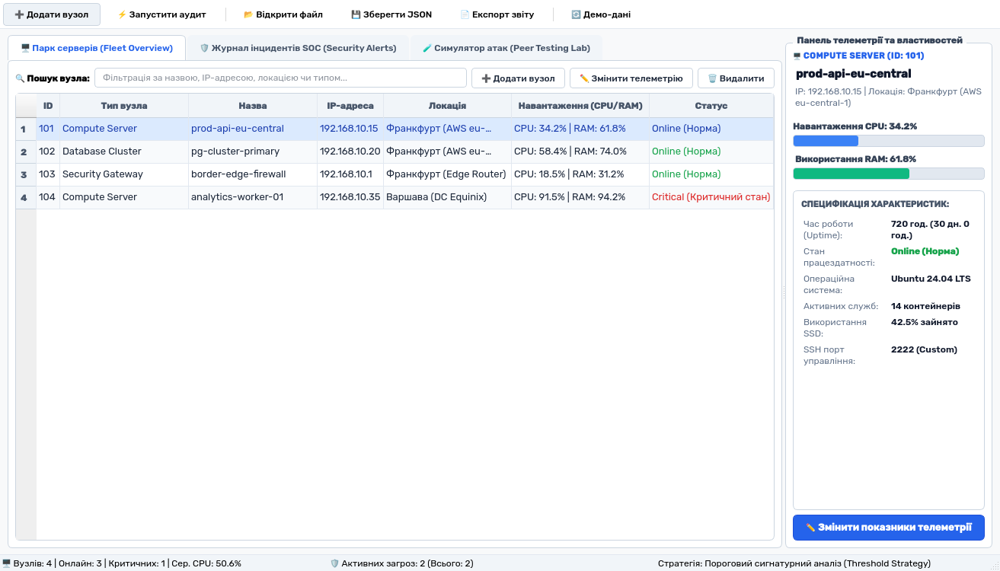
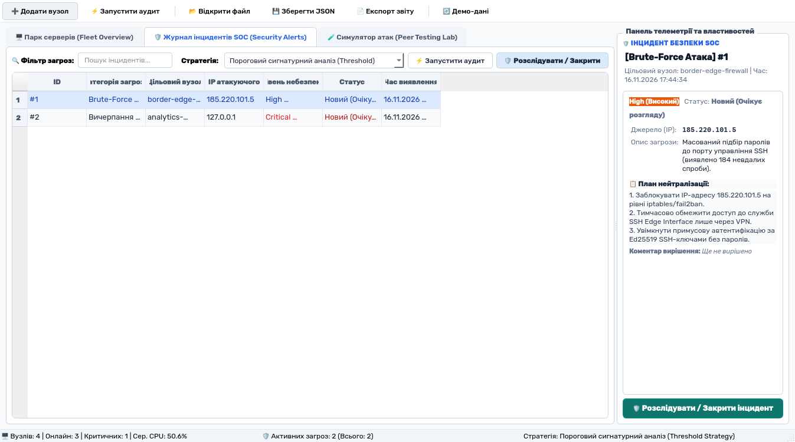
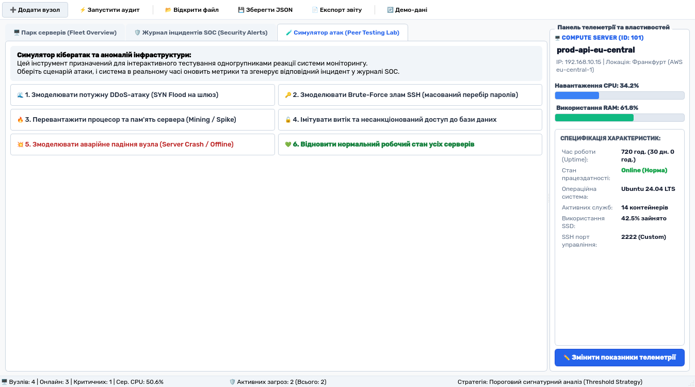

# CyberFleetMonitor

> **Центр моніторингу серверної інфраструктури та кібербезпеки (DevSecOps)**  
> Навчальний MVP-проєкт з курсу «Об'єктно-орієнтоване програмування» (ТНТУ, кафедра програмної інженерії).

---

## 1. Опис проєкту

**CyberFleetMonitor** — це десктопний графічний застосунок на базі **C++17** та **Qt 6**, створений для вирішення ключової проблеми сучасної методології **DevSecOps** — ліквідації розриву між моніторингом апаратних ресурсів серверів (DevOps/SRE) та реагуванням на загрози безпеки (SecOps).

Застосунок об'єднує телеметрію стану серверної інфраструктури та аналітику кіберінцидентів в єдиний робочий простір, мінімізуючи середній час реагування на збої та атаки (MTTR — *Mean Time to Remediate*).

### Ключові можливості MVP:
* **Моніторинг вузлів інфраструктури**: облік та візуалізація метрик (CPU, RAM, Uptime, мережева активність) для різних типів вузлів — серверів застосунків (`ApplicationServerNode`), кластерів баз даних (`DatabaseNode`) та мережевих шлюзів (`NetworkGatewayNode`).
* **Аналітика та виявлення аномалій**: використання взаємозамінних алгоритмів аналізу на основі патерну *Strategy* — порогової стратегії (`ThresholdAnalysisStrategy`) та комплексної евристичної стратегії (`HeuristicAnalysisStrategy`).
* **Управління інцидентами безпеки**: реєстрація атак (Brute-Force, DDoS-аномалії, перевантаження ресурсів), прив'язка інцидентів до конкретних вузлів та автоматична генерація покрокових планів нейтралізації загрози.
* **Симулятор відмов та атак (Chaos Engineering)**: контрольована симуляція стресових навантажень і збоїв інфраструктури для тестування відмовостійкості системи без ризику для реального обладнання.
* **Персистентність даних**: повне збереження та завантаження топології вузлів та історії інцидентів у форматі JSON (`QJsonDocument`).

---

## 2. Скріншоти інтерфейсу

### Моніторинг флоту серверів
Відображення таблиці підключених вузлів інфраструктури, поточних показників завантаження, статусів доступності та детальної інформації про обраний вузол.



---

### Журнал інцидентів та плани нейтралізації
Моніторинг активних кіберзагроз із зазначенням рівня критичності (Severity), цільового сервера, детального опису та згенерованого плану реагування інженера.



---

### Симулятор навантаження та атак (Chaos Engineering)
Панель вибору сценаріїв збоїв (DDoS-атака, витік пам'яті, підбір паролів SSH) для перевірки реакції алгоритмів моніторингу в режимі реального часу.



---

## 3. Інструкція зі збірки

### Системні вимоги:
* **Компілятор C++**: GCC $\ge$ 9.0 або Clang $\ge$ 10 (підтримка стандарту C++17)
* **Фреймворк**: Qt 6 (модулі `Qt6::Core`, `Qt6::Widgets`)
* **Система збірки**: CMake $\ge$ 3.16 або Make

---

### Збірка за допомогою CMake:

1. **Клонування репозиторію**:
   ```bash
   git clone https://github.com/yamerodf/cyber-fleet-monitor.git
   cd cyber-fleet-monitor
   ```

2. **Конфігурація проєкту**:
   ```bash
   cmake -B build -DCMAKE_BUILD_TYPE=Release
   ```

3. **Компіляція**:
   ```bash
   cmake --build build -j$(nproc)
   ```

4. **Запуск застосунку**:
   ```bash
   ./build/cyber_monitor
   ```

5. **Запуск автоматичних модульних тестів**:
   ```bash
   ./build/test_monitoring
   ```

---

### Швидка збірка за допомогою Makefile:

Для зручності у проєкті налаштований `Makefile`, що автоматизує виклики CMake:

```bash
# Збірка програми та тестів
make

# Запуск тестів
make test

# Запуск програми
make run

# Очищення тимчасових файлів збірки
make clean
```
